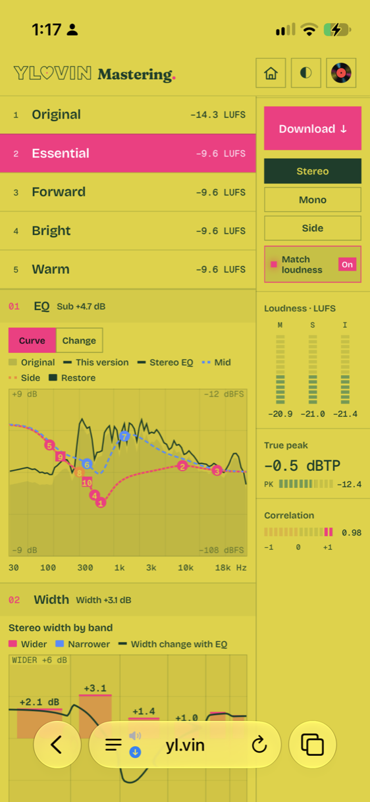
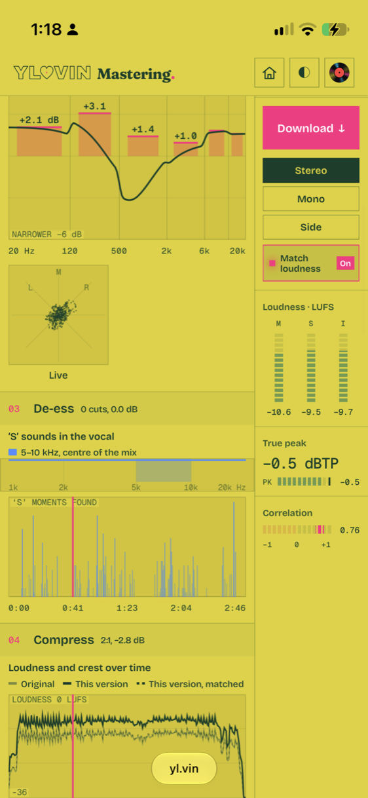
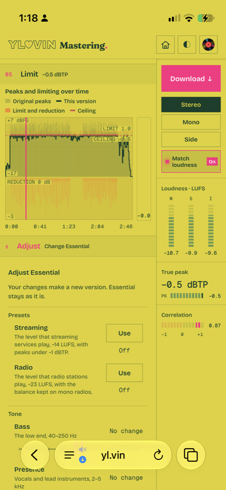

# Mastering engine

The mastering engine is a deterministic offline mastering pipeline for stereo
mixes, written in Rust. Signal processing and psychoacoustics are its
foundation. Optional aligned stem estimates inform the analysis. The renderer
always processes the original stereo mix.

The engine runs the mastering page of [yl.vin](https://yl.vin/master).

<p>
  
  
  
</p>

This repository contains the `mastering-engine` library and the `master`
command-line tool. The interface of the yl.vin page is a separate app and is
not in this repository.

## Engine and interface

The engine makes the versions and every processing measurement that the page
shows. A set writes them to `set.json` and to the render report of each
version:

- The versions, their names and their integrated loudness.
- EQ: the curve of each version against the mix, by band, for the stereo,
  mid and side.
- Width: the stereo width of each band and the change from the EQ.
- De-ess: the band of the sibilant frames, the keyed frames on a timeline,
  and the cut of each frame.
- Compress: the ratio, the gain reduction, and the loudness and crest over
  time.
- Limit: the peaks over time, the gain reduction and the ceiling.
- Adjust: the steps and presets that each version can take.

The meter column of the page measures the playback in the browser: the
momentary, short-term and integrated loudness, the true peak, the
correlation and the goniometer. These meters are part of the app.

## Quick start

Install Rust with [rustup](https://rustup.rs), then build the tool:

```sh
git clone https://github.com/wavey-ai/mastering.git
cd mastering
cargo build --release --locked
```

Make a set of masters from a stereo WAV mix. The output directory must not
exist:

```sh
target/release/master set mix.wav masters
```

The directory gets one WAV and one render report for each version, the set
manifest `set.json`, and `index.html`. Open `index.html` in a browser to
listen to the versions and compare them with the mix.

Aligned stems give the engine more evidence for the tone, the width and the
de-esser. Give the directory of the four stems (drums, bass, other, vocals):

```sh
target/release/master set mix.wav masters-stems --stems path/to/stems
```

Turn on the de-esser with `--deesser true`. Measure a file without
mastering it:

```sh
target/release/master inspect mix.wav
```

Run the tests:

```sh
cargo test --release --locked
```

## Documents

- [`docs/DECISIONS.md`](docs/DECISIONS.md): the decision log. Each entry
  gives the decision, its date, its reason, the alternatives and the dated
  updates.
- [`docs/RULES.md`](docs/RULES.md): the active rules of the engine, by rule
  ID.

## Design scope

`master set` generates the distinct masters that the material supports. The
number of versions depends on the material. The set takes no sound-direction
input. The user listens to the versions and chooses one.

The engine gives musical results and sets the processor settings itself. The
design covers five dimensions:

- **Frequency and phase:** tonal balance, resonances, filter response, and timing relationships.
- **Dynamics over time:** attacks, sustain, release, pumping, and contrast between passages.
- **Nonlinear behavior:** level-dependent harmonics, intermodulation, clipping, and aliasing.
- **Stereo behavior:** correlation, frequency-dependent width, center stability, and mono compatibility.
- **Perception:** loudness, masking, brightness, and preference at matched loudness.

For example, punch involves transient-to-sustain contrast, frequency content,
and the effects of subsequent limiting. STFT and mel analysis supply
measurements. Musical intent and listener preference need more than these
measurements.

The engine measures the source, proposes a bounded change, renders it,
compares the result, and then keeps or rejects the change. Unchanged
processing stays a candidate. The runtime uses deterministic DSP and explicit
rules. It uses no trained model and no reference track. No corpus, reference
or genre sets a target.

## Build

```sh
cargo build --release --locked
```

The build writes the command-line tool to `target/release/master`.

## Commands

```text
master set INPUT.wav NEW_OUTPUT_DIRECTORY [--format pcm24|pcm16|float32]
  [--stems DIRECTORY] [--auditory-analysis ANALYSIS.json]
  [--album-lufs N] [--deesser true|false]
master set-plan INPUT.wav NEW_PLAN.json [--stems DIRECTORY]
  [--auditory-analysis ANALYSIS.json]
master render-family INPUT.wav PLAN.json FAMILY_ID NEW_OUTPUT_DIRECTORY
master adjust INPUT.wav PLAN.json VERSIONS.json PARENT_ID NEW_OUTPUT_DIRECTORY
  [--id ID] [--preset streaming|club|radio|mono|mono-safe]
  [--bass N] [--presence N] [--air N] [--sibilance N] [--loudness N]
  [--width N] [--compression N] [--ceiling -N]
master inspect INPUT.wav
master help
```

| Command | Function |
|---|---|
| `set` | Plans, renders, verifies and names a complete set in a new directory |
| `set-plan` | Writes the worker plan of a set to a new JSON file |
| `render-family` | Renders one family of a worker plan to a new directory |
| `adjust` | Renders a request on a delivered version as a new version |
| `inspect` | Prints the measurements of a WAV file as JSON |

Each command that writes output refuses an existing output path.

### Example

```sh
mkdir -p build
target/release/master set mix.wav build/my-new-masters --format pcm24
target/release/master set mix.wav build/my-new-masters-stems \
  --stems path/to/aligned-stems
target/release/master inspect mix.wav
```

Open `set.json` and the version WAVs in an audio player, or open `index.html`
in a browser.

## Input

The input is a finite stereo RIFF WAV file with at least three seconds of
samples. The reader accepts PCM16, PCM24, PCM32 and float32. The supported
input rates are 44.1, 48, 88.2, 96, 176.4 and 192 kHz.

The engine renders at the rate family of the source:

- 44.1 kHz for a source at 44.1, 88.2 or 176.4 kHz.
- 48 kHz for a source at 48, 96 or 192 kHz.

A source at 44.1 or 48 kHz has no rate conversion. The resampler converts a
source at a higher rate down by a factor of 2 or 4. Each delivered file is at
the render rate. `set.json` gives the source rate and the render rate. The
renderer keeps the source file and the duration of the source at the render
rate.

## Stems

`--stems DIRECTORY` supplies aligned stem estimates to `set` and `set-plan`.
The directory contains aligned, unnormalized `drums.wav`, `bass.wav`,
`other.wav` and `vocals.wav`. The stemsplits project generates the stems.

Four aligned stems enable these stages:

- All-role, full-range measurements.
- Conditional two-second EQ envelopes that every family shares.
- Local auditory focus proposals and source refinement.

Refinement measures the focus strength with the candidate filters. It
derives the recovery timing from the drums and the bass. It eases the focus
through passages that the measurements do not support. All output processing
uses the original stereo mix. When a measurement is unreliable, the stage
keeps its default setting and reports the reason.

`--auditory-analysis ANALYSIS.json` supplies an offline source analysis
report. The report supplies region hypotheses for the focus proposals. The
report must match the hash, the native rate and the frame count of the input
file. The report must contain valid source and stem diagnostics. The engine
ignores paired reference spectra in the report. Refinement also needs the
aligned stems. A four-stem set measures the
auditory analysis natively and needs no analysis file.

## Set output

`set` creates a new directory. It writes these files:

| File | Content |
|---|---|
| `LABEL [ID] - TRACK.wav` | One delivered version |
| `LABEL [ID] - TRACK.json` | The delivery report of that version (`mastering.set-version-delivery.2`) |
| `set.json` | The set manifest (`mastering.native-set-delivery.2`) |
| `analysis-and-trials.json` | The analysis, the trials and the source condition |
| `index.html` | The audition page, a copy of `scripts/set-review.html` |
| `ORIGINAL.wav` | An exact copy of the input |
| `progress.jsonl` | Append-only progress events |

The engine decodes and verifies each WAV before the next version renders. A
final manifest and a `complete` event mark success. After a failure or a host
interruption, the partial results stay in the directory. A `failed` event in
`progress.jsonl` gives the reason.

`--format` selects the word length of the delivered WAVs. PCM24 is the
default. PCM16 and float32 are also available. Integer export receives
final-stage TPDF dither.

The reports include the strength probes, the passage controls and the timing
basis. Each progress event except `failed` gives the elapsed time
(`elapsed_seconds`). Each delivery records the
render, measurement and comparison time, and the WAV write and verification
time. `set.json` gives the preparation time separately.

## Set versions

A set has up to four versions, with the IDs `essential`, `master`, `bold` and
`open`. The IDs are stable. They identify each version in playback, reports
and downloads.

- `essential` keeps the tone and the stereo image of the mix.
- `master` adds the tonal moves of the recording, the strongest stem focus
  proposal, the de-esser, the low-mid correction from the stems, and the
  widening.
- `bold` keeps the corrections of `master` and adds more presence, treble and
  width.
- `open` keeps the tone of the mix and adds two low shelves and the widest
  widening.

### `master`

The tonal moves of `master` are these:

- Equal-loudness compensation at the normalized playback level.
- Presence balance, with a presence move of at most 0.94 dB.
- The masking deficit of the lead role, from aligned stems.

The de-esser (`set.deesser.v4`) cuts only when the de-esser switch is on. The
widening of the band from 120 to 500 Hz goes toward a fixed target within
the allowance of the band. Each widening band stays within a fixed bound.

When the drums and bass stems hold more than half of the stem power from 40
to 120 Hz, `master` also gets the two low shelves of `open`. The low-end gate
then checks the bands under 500 Hz in place of their tonal gates. When no
candidate with the shelves passes, `master` is delivered without them.

### `bold`

`bold` adds up to 1 dB of presence against body. The result is at most
0.48 dB beyond the presence bound of `master`. Where the treble is material,
`bold` adds 0.5 dB of treble against body to the tone of `master` without the
bass shelves. It uses the `bold` widening, with each band within a fixed
bound. When `master` chooses no candidate, `bold` builds from the first
planned `master` candidate.

### Bass hold

`master` and `bold` hold the bass of each 15 s section within 0.5 dB of
`essential` at matched loudness. Bells on the held bands make the hold. The
loudness match includes the loudness of the lifts in every band.

### `open`

`open` keeps the tone of the mix and adds two low shelves. One shelf lifts
the sub against the bass. The other lifts the bass against the body. `open`
widens every band toward a fixed target, most in the bass and the low mids,
within a maximum for each band. It renders at the base target.

A set delivers `open` only when the low end of the mix is narrow and
correlated enough. The low end must admit at least 1 dB of the widening in
both bands under 500 Hz, within the window bound of the other versions
(`set.open.v3`).

### Candidates and screens

Each version is a candidate ladder. The strongest candidate renders first.
The first candidate that passes its gates against the `essential` render is
delivered.

The engine screens out these versions:

- A version that differs from a delivered version by less than 0.5 dB at
  matched loudness in each measure.
- A version that matches the mix in delivered level and in each measure.

Each description compares its version with the mix.

A band is material when it holds 1% of the raw power of the strongest band.
A band is also material when it holds 1% of the total power weighted by the
75-phon equal-loudness contour. The gates, the descriptions and the duplicate
screen use the material bands. A delivery fault excludes a candidate. The
reports give the preservation limits as diagnostics. These limits do not
reduce or reject a version. The reports also give the gain-matched residual
as a diagnostic.

### Names and character

After the last version, each delivered version gets a name and a description
from its measured sound (`set.version-names.v1`). For example, the bass
version is named Full. The names describe the measured changes in that
recording, such as "More centre body" or "Broader low mids".

Each version has a character (`set.version-character.v1`). The character is
a move of the low mids, the presence, the air, the sub and the bass, and a
width for each of six bands.

### Loudness

Each version sits at the audibility point of its own chain
(`set.audible-loudness.v6`). The audibility point is the loudest output at
which these two conditions are true:

- The masked disturbance of peak control is at the masking threshold.
- The P90 attack loss against the mix is at most 5.45 dB.

`--album-lufs N` gives the target of the track in its album, in LUFS. Each
version of the track sits at or under this target (`album.levels.v2`).

### De-esser

`--deesser false` is the default. The de-esser keeps its key and its measure
and cuts nothing.

With `--deesser true`, the de-esser of a version cuts the 5 to 10 kHz band of
the mid channel. It cuts only in the keyed frames of the vocal stem. The
de-esser operates as follows:

1. The reference excess is the 90% quantile of the excess of the keyed frames.
2. The cut of a frame is its excess over the reference excess, times the
   vocal share of the frame.
3. The maximum cut is 3 dB.
4. When the cut removes more than 0.3 dB of the band energy of the drum, bass
   and other stems, the version halves the maximum cut.
5. When the half cut also removes more than 0.3 dB, the version cuts nothing.

The render report of each version gives the result in `render.deesser`, with
the reference excess in `reference_excess_db`.

The `deesser` field of a set request sets the same switch. The field is
`true`, `false` or `null`. A request without the field, or with `null`, cuts
no frame.

## Source condition

`set.json` and `analysis-and-trials.json` report the source condition:

- Mono.
- The bandwidth of a codec low-pass.
- The input condition.
- A quiet input (`input_quiet`, −24 LUFS or less).
- The anti-phase bands.
- The DC offset of each channel, in dBFS.
- With stems, an anti-phase instrument group: a stem whose channels cancel
  in a band while the other stems are in phase, with its time range.

The engine aligns a source with an anti-phase band before every other stage.
Each channel turns by half the measured phase where the phase is consistent
and beyond 90°.

The engine proposes a tonal move only when its gate band holds material
energy.
A captured recording is mono, has a codec low-pass or has an anti-phase band.
A captured recording takes no equal-loudness move.

A device capture is a captured recording that meets one of these conditions
(`SourceCondition::device_capture`):

- It is mono.
- It has an anti-phase band.
- It has a codec low-pass and arrives at −24 LUFS or less without a limiter.

The `master` version of a device capture moves presence against body up to a
fixed bound. Low shelves move its low band into a fixed range. An MP3 or AAC
copy of a studio mix keeps the bounds of a mix.

## Audition page

`index.html` plays the original and the versions of the set. Matched playback
changes the listening gain only. Downloads keep the delivered levels. A
version switch keeps the playback position. Keep choices apply only to the
exact output set. Essential is the unchanged tonal and spatial anchor. The
original copy keeps its native bytes and rate.

## Adjust

`adjust` renders a request on a delivered version as a new version. It takes
the worker plan of the set and a versions record. The versions record is the
`family.json` of `render-family` or a set manifest.

```sh
target/release/master render-family mix.wav plan.json master build/master
target/release/master adjust mix.wav plan.json build/master/family.json \
  master build/master-adjusted --bass 2 --presence -1 --sibilance -2 --loudness 2 \
  --width 1 --compression 1 --ceiling -1
target/release/master adjust mix.wav plan.json build/master/family.json \
  master build/master-streaming --preset streaming
```

`--id ID` sets the ID of the new version. The default ID is
`PARENT_ID-adjusted`.

### Steps

| Control | Steps | Step size |
|---|---|---|
| `--bass`, `--presence`, `--air`, `--width` | −4 to +4 | 0.5 dB |
| `--sibilance` | −4 to +4 | 0.5 dB |
| `--loudness` | −4 to +4 | 0.5 LU |
| `--compression` | −4 to +4 | 1 dB of compressor threshold |
| `--ceiling` | 0 to −3 | 0.5 dB down from −0.5 dBTP |

A Sibilance step moves from the de-esser cut of the render of the parent. A
step down lowers the threshold to at most 12 dB under the reference excess.
A step down also raises the largest cut to at most 12 dB. A step up lowers
the cut to a minimum of 0 dB. On a version without a de-esser cut, Sibilance
takes the steps down only. With a Compression step, the section make-up
keeps the level of each section.

### Presets

`--preset NAME` renders a preset where the version offers it
(`range.presets`):

- `streaming`: −14 LUFS for a louder version, and a ceiling of −1 dBTP.
- `club`: the audibility point of the set at −1 dBTP less 0.5 LU, and a
  ceiling of −1 dBTP. Each candidate stays at or under the audibility point
  of its own prefix.
- `radio`: −23 LUFS, a ceiling of −1 dBTP and the fold of `mono`.
- `mono`: the fold. Each band that the version widens takes back the side/mid
  of the mix. Its mid takes the power of the added side.
- `mono-safe`: a side cut for each anti-phase band. No version offers it
  (`adjust::MONO_SAFE_OFFERED` is `false`).

### Adjust output

The output directory contains the WAV of the version, its unquantized
render, `adjust.plan.json` and `adjust.json` (`mastering.adjust-result.2`).
`adjust.json` gives these fields:

- The delivered share of the steps and the delivered steps.
- The warnings: `loudness-above-audibility-point` and `limiter-workload`.
- The measured change against the parent at matched loudness, for each
  control.
- `duplicate_of`, when the version sounds the same as the mix or another
  version. The engine does not deliver a duplicate.
- The reason `outside-range`, when no share of the request is in the range
  of the version (`adjust::range`). The engine renders nothing.
- `medium`, for a medium preset: the delivered level, ceiling and true peak,
  with those of the parent. It also gives the change of the PLR, of each band
  at matched loudness, of the width and of the work of peak control. With
  the fold, it gives the predicted change of the mono sum of each band. It
  also gives the mono fold-down loss of each band of the mix and of the
  result.
- `version`: the version record (`mastering.web-set-version.1`) with its
  name, description, `signature`, `measures` and `adjusted` fields.

A version of a family result has no stored facts. `adjust` measures them
from the WAV of the version beside `family.json`.

The worker plan of a request marks its version `lifted`. The version keeps
the shelves of its parent, including the sub lift, and renders no sub lift.

## Plan and report contract

The worker plan (`mastering.worker-plan.8`) and the set manifest
(`mastering.distributed-set.4`) keep the render rate of the set
(`sample_rate`). They also keep the planner facts of a request
(`adjust::Facts`):

- The source spectrum in 1/24-octave bands.
- The audibility point.
- The band of the source.
- The signature of the mix.

The manifest keeps these facts in `adjust` (`adjust::Base`) with the
`essential` spec. Each version record of the manifest keeps its `signature`
and its `measures`.

A family result (`mastering.worker-family.2`) lists in `unchosen` each
version that rendered candidates and chose none. For each such version it
gives the trial of each candidate (`candidates`). It also gives the IDs of
the checks that each trial failed (`failed_gates`). The manifest trial of
that version has the status `no-opportunity` and keeps both fields.

## Inspect

`inspect` prints JSON with these measurements:

- Waveform, spectral, temporal and loudness measurements.
- The reconstructed peak estimate, in dBTP.
- Time-dependent stereo measurements in six frequency bands.

## Code

| Module | Responsibility |
|---|---|
| `wav.rs` | RIFF parsing and float32 output |
| `dsp.rs` | Filters, K-weighted loudness, sinc oversampling, linked limiting |
| `analysis.rs` | Temporal measurements and before/after preservation checks |
| `compressor.rs` | Linked compression with the section make-up, the glue settings and the compression styles of a set |
| `finishing.rs` | Domain EQ, dynamic bands, section gain, harmonic color, and bounded clipping |
| `resample.rs` | Windowed-sinc conversion between supported source rates |
| `delivery.rs` | Final dither, integer export, decoded-file verification, and copies at a different sample rate or word length |
| `bench.rs` | Coherent test tones and tone measurements |
| `stereo.rs` | Windowed mid/side energy, correlation, phase, coherence, and mono measurements |
| `waveform.rs` | Absolute 384-bin stereo peak/RMS source and output envelopes |
| `imaging.rs` | Measured range checks for set candidates |
| `pipeline.rs` | Source analysis and diagnostic preservation constraints |
| `set.rs` | Set planning, rendering, selection and delivery |
| `character.rs` | The character of each version of a set and the solve of its tone |
| `album.rs` | The summary of each track of an album, the running order and the album levels |
| `distributed.rs` | Family renders, the set finalizer and the file store of a render |
| `adjust.rs` | Requests on a delivered version: candidates, finalizer, names and preview |
| `excerpt.rs` | Span render of a version from the fixed state of its render |
| `search.rs` | Bounded loudness search, measured probes, and termination reasons |
| `lib.rs` | Stereo waveform, STFT, and raw mel measurements |
| `main.rs` | File commands, options, and hashes |

The `mel-spec` dependency supplies the STFT and the mel projection at a
pinned Git revision. Its standard FFT and array dependencies are in
`Cargo.lock`. Serialization and hashing use `serde`, `serde_json` and `sha2`.
The mastering controller and the DSP are in this repository.

## Tests

```sh
cargo fmt --check
cargo clippy --locked --all-targets -- -D warnings
cargo test --release --locked
```

The Rust tests use synthetic audio and the JSON fixtures in `tests/data/`.

## Audio I/O and block rendering

The engine uses SoundKit for streaming WAV decoding and encoding.
`src/audio_io.rs` applies the input and output policy of the engine. The
adapter keeps the sample precision and refuses to replace an output file.

Peak control uses state-preserving blocks and overlapping downsampling
windows. Native sets and treatment batches store the prepared prefix and the
search probes in temporary files. They read bounded blocks and keep float32
samples exactly. The source PCM and the selected output stay in RAM. The
engine measures raw stems in sequence. Refinement uses the reconstructed sum
again as its accompaniment buffer.

### Temporary storage

Temporary files use the temporary directory of the operating system:

- On Unix, the files have owner-only permissions. The engine unlinks each
  file immediately after it opens it. The open handle keeps the file usable.
  When the engine drops the handle, the storage is released.
- On other native platforms, the engine closes and removes each file when it
  drops the handle.

On Unix, set `TMPDIR` before launch to select a writable scratch volume. Use
disk-backed storage to reduce RAM use. A RAM-backed temporary directory uses
RAM for the scratch files.

### Memory

Allow approximately six float32 source buffers plus 128 MiB for the scratch
storage of the renderer. This bound covers the 4× prefix, the kept probe
cache and two search candidates. Delivered WAVs need separate storage.
Operating system file caches also use reclaimable memory. A scratch error
stops the job. Completed deliveries stay in the output directory.

### Parallel versions

A native `master set` renders `master`, `bold` and `open` at the same time,
after `essential`. This applies to a recording of up to five minutes
(`set::PARALLEL_VERSIONS_SECONDS`, `Sink::parallel_versions`).

`bold` renders from the first planned `master` candidate, as the `bold`
family of the cloud does. It starts when `master` renders that candidate
first. It stops when `master` renders another candidate. In these cases,
`bold` renders after `master`.

The events, the comparisons and the deliveries keep the order of the plan.
The files and the reports are the same as those of a render in order. The
parallel renders keep their scratch storage in the temporary directory.
During these renders, a set holds up to three renders in memory.

`MASTERING_THREADS=N` limits the engine to N threads, for measurement. Each
result is the same at all thread counts. Peak control of a recording longer
than 60 s renders in parallel 60 s segments
(`render_blocks::render_segmented`). `MASTERING_SEGMENTED_MIN_SECONDS`
changes this threshold, for measurement.

### Embedded hosts

An embedded host can implement `Read + Write + Seek` and supply a
`scratch::Factory` through `Sink::scratch_factory`. Each factory call must
return new, independent storage at byte zero. Each handle must own its
cleanup. `Renderer::with_scratch` gives the same interface for explicit
treatment jobs.

A browser host can supply OPFS scratch storage. While a host is set
(`scratch::set_host`), `scratch::temporary` also takes its storage from the
host. Without a host, it uses memory.

## Limits

- The engine measures broadband transient contrast. Perceived punch and
  instrument-specific articulation are outside its measurements.
- The analysis uses fixed 12-second windows. It uses no verse or chorus
  labels.
- The engine reports clipping indicators. It does not repair existing
  distortion.
- The compressor has no FET, VCA, optical, tube or transformer coloration.
- The set does not identify instruments.
- A band that the side gain cannot widen gets its width from the mid with a
  90° phase shift. An example is each band of a mono recording above 120 Hz.
  The sign of the shift alternates in each ERB. The mono sum stays the mid.
- The engine delivers stereo files only. Vinyl cutting, Atmos, stem mixing,
  DDP assembly, restoration and coded-media delivery are outside its scope.
- The limiter holds recurring crests for 12 ms and uses a 3 ms lookahead. It
  has no sustained release stage.
- Set versions deliver at −0.5 dBTP with 1.5 dB or 2.5 dB of
  ceiling-relative soft clipping.
- The peak estimator uses the 4× windowed-sinc filter of the engine and
  native sample peaks. It has no formal true-peak conformance test.
- The set renderer uses temporary storage for oversampled audio and a
  noncausal limiter envelope. Phone and real-time use need separate
  engineering.

## Licensing

The Wavey Artist Source Licence applies to this repository. Refer to `LICENSE`.

- Qualifying Artists and Artist Entities can use the engine to master and sell
  their own music.
- Any person can study, run and modify the engine for personal experimentation,
  education, evaluation or non-commercial research.
- A label, platform, service provider or other commercial user must get a
  separate licence from licence@yl.vin.
